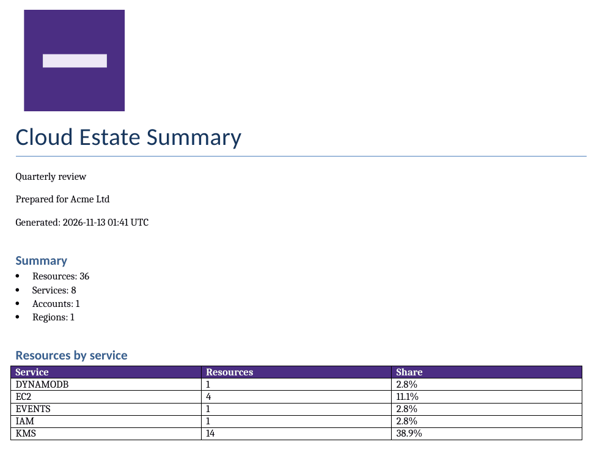

# Example: branded executive Word report

**Goal:** a short Word document for leadership with your logo and colours:
totals, services and tag compliance, without per-resource tables.

**You need:** read-only credentials and a logo as a PNG, JPEG, GIF or BMP
file. Word cannot embed SVG logos.

## Template

Put the logo next to the template, in the same folder or a subfolder:

```text title="Project layout"
.inventag/templates/
  board-report.yaml
  brand/
    acme-logo.png
```

```yaml title=".inventag/templates/board-report.yaml"
format_version: 1
kind: report
name: board-report
description: Branded summary for the leadership team
extends: executive-summary
spec:
  title: Cloud Estate Summary
  subtitle: Quarterly review
  company_name: Acme Ltd
  logo: brand/acme-logo.png
  logo_alt_text: Acme Ltd logo        # read by screen readers
  colors:
    header_fill: "4B2E83"             # 10.4:1 contrast with white text
  tag_policy: security-baseline
  word:
    orientation: landscape
```

## Command

```bash title="Terminal"
inventag templates validate board-report
inventag --template board-report --create-word --account-regions us-east-1
```

## Output

<!-- BEGIN EXAMPLE OUTPUT: board-validate -->

```text title="Terminal"
OK    ~/acme-infra/.inventag/templates/board-report.yaml (report 'board-report')
```

<!-- END EXAMPLE OUTPUT: board-validate -->

<!-- BEGIN EXAMPLE OUTPUT: board-console -->

```text title="Terminal"
inventag - WARNING -   - No account specification method provided. Using default AWS credentials.
Wrote bom_output/tag_compliance_20261112_090000.json
Wrote bom_output/multi_account_bom_20261112_090000.docx
Tag policy 'security-baseline': 1 of 23 resources compliant (4.3%), 22 non-compliant, 14 out of scope.
```

<!-- END EXAMPLE OUTPUT: board-console -->

<!-- BEGIN EXAMPLE OUTPUT: board-word -->

**Document outline:**

- **Cloud Estate Summary** (title)
- Summary
- Resources by service
- Tag compliance
  - Required tags
  - Non-compliant resources
- About this report

A table from the document:

| Tag key | Rule | Missing | Invalid value |
|---|---|---|---|
| Owner | Any value | 17 | 0 |
| Environment | One of: prod, staging, dev, test, sandbox (an... | 17 | 1 |
| DataClassification | One of: public, internal, confidential, restr... | 22 | 0 |

<!-- END EXAMPLE OUTPUT: board-word -->

<!-- BEGIN EXAMPLE OUTPUT: board-image -->



<!-- END EXAMPLE OUTPUT: board-image -->

<!-- BEGIN EXAMPLE OUTPUT: board-downloads -->

[Download the sample Word report](pathname:///inventag-aws/downloads/board-report-sample.docx) (38 KB, sample data)

<!-- END EXAMPLE OUTPUT: board-downloads -->

If the logo is missing, or is not an image Word supports, the run stops before
scanning:

<!-- BEGIN EXAMPLE OUTPUT: board-missing-logo -->

```text title="Terminal"
inventag - ERROR - Template problem:
inventag - ERROR -   ~/acme-infra/.inventag/templates/board-report.yaml:10: spec.logo: logo file not found: ~/acme-infra/.inventag/templates/brand/acme-logo.png
$ echo $?
1
```

<!-- END EXAMPLE OUTPUT: board-missing-logo -->

## Next steps

- Keep colours readable: pick a header colour with a contrast ratio of at
  least 4.5:1 against the header text.
- Add the full inventory as an Excel file:
  `inventag --template board-report --create-word --create-excel`.
