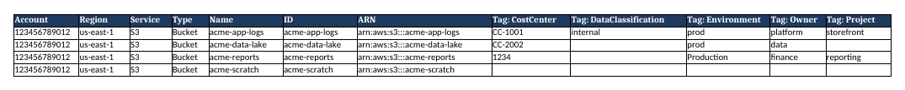
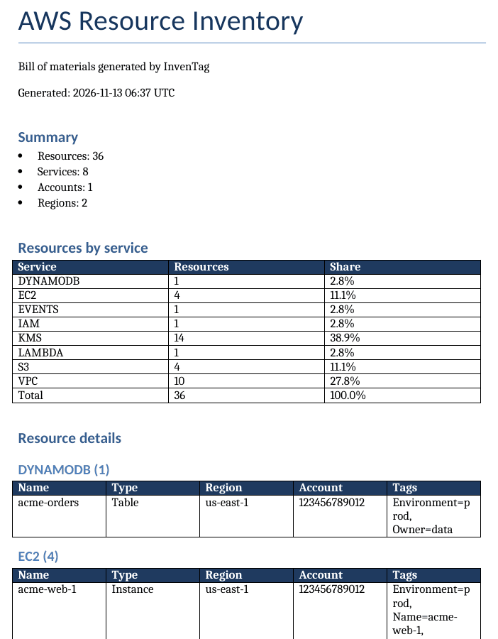

# Built-in templates

**Who this is for:** anyone choosing a starting point.

**What you can do after reading:** pick the template that is closest to what
you need and know exactly what it will produce.

To list them, run `inventag templates list`. To print one, run
`inventag templates show <name>`; add `--resolved` to see the result
after inheritance and defaults.

<!-- BEGIN EXAMPLE OUTPUT: catalogue-list -->

```text title="Output"
NAME                    KIND        SOURCE   DESCRIPTION
executive-summary       report      builtin  Short Word report with totals and tag compliance; Excel has one filterable sheet.
finops-cost-report      report      builtin  Standard layout with cost-allocation tag columns, checked against finops-cost-allocation.
standard-bom            report      builtin  Summary plus one sheet per service, with readable columns and every tag as a column.
evidence-gdpr           tag-policy  builtin  Tag evidence for resources that may hold personal data: personal-data type, processing-record reference, data residency, retention. Checks tag evidence only; certifies nothing.
evidence-hipaa          tag-policy  builtin  Tag evidence for resources that may hold protected health information: PHI flag, classification, retention period. Checks tag evidence only; certifies nothing.
evidence-pci-dss        tag-policy  builtin  Tag evidence for cardholder-data scoping: PCI scope and how the resource handles card data. Checks tag evidence only; certifies nothing.
evidence-pdpa           tag-policy  builtin  Tag evidence for resources that may hold personal data: personal-data flag, purpose, retention, location. Checks tag evidence only; certifies nothing.
evidence-soc2           tag-policy  builtin  Tag evidence for SOC 2 scoping conversations: scope, system, provisioning method, criticality. Checks tag evidence only; certifies nothing.
finops-cost-allocation  tag-policy  builtin  Requires CostCenter, Owner, Project and Environment so spend can be allocated.
security-baseline       tag-policy  builtin  Requires Owner, Environment and DataClassification for security reviews.
ci-pipeline             config      builtin  Excel report plus tag-compliance JSON; exits with code 3 on tag policy violations.
org-multi-account       config      builtin  Assume a read-only role in each listed account and write one consolidated report.
single-account          config      builtin  Scan the account of your current credentials and write Excel and Word reports.

Search order (first match wins):
  1. project  ~/acme-infra/.inventag/templates  (not created)
  2. user     ~/.config/inventag/templates  (not created)
  3. builtin  ~/inventag-aws/inventag/templating/builtin
```

<!-- END EXAMPLE OUTPUT: catalogue-list -->

The samples on this page come from offline runs against mocked AWS (sample
data). The account and the `acme-*` resources are made up.

## Report templates

| Name | Excel workbook | Word document |
|---|---|---|
| `standard-bom` | Summary sheet, then one sheet per service. Columns: Account, Region, Service, Type, Name, ID, ARN, then one column per tag key found on that sheet. Header row frozen, with filter buttons. | Cover, summary, resources by service, tag compliance (if a policy is active), one table per service (up to 50 rows each), about this report. |
| `executive-summary` | Summary sheet and one `Resources` sheet with every resource, no tag columns. | Cover, summary, resources by service, tag compliance (if a policy is active), about. No per-resource tables. |
| `finops-cost-report` | Like `standard-bom`, but the tag columns are fixed to CostCenter, Owner, Project and Environment, plus a Tag Compliance sheet. | Cover, summary, tag compliance, resources by service, about. |

`executive-summary` and `finops-cost-report` both `extends: standard-bom`, so
they only list what is different. `finops-cost-report` also turns on the
`finops-cost-allocation` tag policy.

The header colour in all three is dark blue (`1F3A5F`) with white text.

### standard-bom

Command: `inventag --template standard-bom --create-excel --create-word --account-regions us-east-1`

<!-- BEGIN EXAMPLE OUTPUT: standard-excel-summary -->

**Sheets:** `Summary`, `ATHENA`, `DYNAMODB`, `EC2`, `EVENTS`, `IAM`, `KMS`, `LAMBDA`, `S3`, `VPC`

`Summary` sheet:

> AWS Resource Inventory  
> Bill of materials generated by InvenTag  
> Generated: 2026-11-12 09:00 UTC  
> Accounts: 1   Regions: 2  

| Service | Resources | Share |
|---|---|---|
| ATHENA | 1 | 2.7% |
| DYNAMODB | 1 | 2.7% |
| EC2 | 4 | 10.8% |
| EVENTS | 1 | 2.7% |
| IAM | 1 | 2.7% |
| KMS | 14 | 37.8% |
| LAMBDA | 1 | 2.7% |
| S3 | 4 | 10.8% |
| VPC | 10 | 27.0% |
| Total | 37 | 100.0% |

<!-- END EXAMPLE OUTPUT: standard-excel-summary -->

<!-- BEGIN EXAMPLE OUTPUT: standard-excel-s3 -->

**Sheets:** `Summary`, `ATHENA`, `DYNAMODB`, `EC2`, `EVENTS`, `IAM`, `KMS`, `LAMBDA`, `S3`, `VPC`

`S3` sheet, first rows:

| Account | Region | Service | Type | Name | ID | ARN | Tag: CostCenter | Tag: DataClassification | Tag: Environment | Tag: Owner | ... |
|---|---|---|---|---|---|---|---|---|---|---|---|
| 123456789012 | us-east-1 | S3 | Bucket | acme-app-logs | acme-app-logs | arn:aws:s3:::acme-app-logs | CC-1001 | internal | prod | platform | ... |
| 123456789012 | us-east-1 | S3 | Bucket | acme-data-lake | acme-data-lake | arn:aws:s3:::acme-data-lake | CC-2002 |  | prod | data | ... |
| 123456789012 | us-east-1 | S3 | Bucket | acme-reports | acme-reports | arn:aws:s3:::acme-reports | 1234 |  | Production | finance | ... |
| 123456789012 | us-east-1 | S3 | Bucket | acme-scratch | acme-scratch | arn:aws:s3:::acme-scratch |  |  |  |  | ... |

The sheet has 12 columns; the first 11 are shown.

<!-- END EXAMPLE OUTPUT: standard-excel-s3 -->

<!-- BEGIN EXAMPLE OUTPUT: standard-excel-image -->



<!-- END EXAMPLE OUTPUT: standard-excel-image -->

<!-- BEGIN EXAMPLE OUTPUT: standard-word -->

**Document outline:**

- **AWS Resource Inventory** (title)
- Summary
- Resources by service
- Resource details
  - ATHENA (1)
  - DYNAMODB (1)
  - EC2 (4)
  - EVENTS (1)
  - IAM (1)
  - KMS (14)
  - LAMBDA (1)
  - S3 (4)
  - VPC (10)
- About this report

A table from the document:

| Service | Resources | Share |
|---|---|---|
| ATHENA | 1 | 2.7% |
| DYNAMODB | 1 | 2.7% |
| EC2 | 4 | 10.8% |
| EVENTS | 1 | 2.7% |
| IAM | 1 | 2.7% |
| KMS | 14 | 37.8% |
| LAMBDA | 1 | 2.7% |
| S3 | 4 | 10.8% |
| VPC | 10 | 27.0% |
| Total | 37 | 100.0% |

<!-- END EXAMPLE OUTPUT: standard-word -->

<!-- BEGIN EXAMPLE OUTPUT: standard-word-image -->



<!-- END EXAMPLE OUTPUT: standard-word-image -->

<!-- BEGIN EXAMPLE OUTPUT: standard-downloads -->

[Download the sample workbook](pathname:///inventag-aws/downloads/standard-bom-sample.xlsx) (14 KB, sample data) and [the sample Word report](pathname:///inventag-aws/downloads/standard-bom-sample.docx) (37 KB, sample data)

<!-- END EXAMPLE OUTPUT: standard-downloads -->

### executive-summary

Command: `inventag --template executive-summary --create-excel --create-word --account-regions us-east-1`

<!-- BEGIN EXAMPLE OUTPUT: exec-excel -->

**Sheets:** `Summary`, `Resources`

`Resources` sheet, first rows:

| Account | Region | Service | Type | Name | ID | ARN |
|---|---|---|---|---|---|---|
| 123456789012 | us-east-1 | ATHENA | WorkGroup | primary | primary | arn:aws:athena:us-east-1:123456789012:workgro... |
| 123456789012 | us-east-1 | DYNAMODB | Table | acme-orders | acme-orders | arn:aws:dynamodb:us-east-1:123456789012:table... |
| 123456789012 | us-east-1 | EC2 | Instance | acme-web-1 | i-855a01aabe3d29d3a | arn:aws:ec2:us-east-1:123456789012:instance/i... |
| 123456789012 | us-east-1 | EC2 | Snapshot |  | snap-3585ce88e25ef1196 | arn:aws:ec2:us-east-1::snapshot/snap-3585ce88... |

<!-- END EXAMPLE OUTPUT: exec-excel -->

<!-- BEGIN EXAMPLE OUTPUT: exec-word -->

**Document outline:**

- **AWS Inventory Summary** (title)
- Summary
- Resources by service
- About this report

A table from the document:

| Service | Resources | Share |
|---|---|---|
| ATHENA | 1 | 2.7% |
| DYNAMODB | 1 | 2.7% |
| EC2 | 4 | 10.8% |
| EVENTS | 1 | 2.7% |
| IAM | 1 | 2.7% |
| KMS | 14 | 37.8% |
| LAMBDA | 1 | 2.7% |
| S3 | 4 | 10.8% |
| VPC | 10 | 27.0% |
| Total | 37 | 100.0% |

<!-- END EXAMPLE OUTPUT: exec-word -->

### finops-cost-report

Command: `inventag --template finops-cost-report --create-excel --create-word --account-regions us-east-1`

<!-- BEGIN EXAMPLE OUTPUT: finops-excel-s3 -->

**Sheets:** `Summary`, `ATHENA`, `DYNAMODB`, `EC2`, `EVENTS`, `IAM`, `KMS`, `LAMBDA`, `S3`, `VPC`, `Tag Compliance`

`S3` sheet, first rows:

| Account | Region | Service | Type | Name | ID | ARN | Tag: CostCenter | Tag: Owner | Tag: Project | Tag: Environment |
|---|---|---|---|---|---|---|---|---|---|---|
| 123456789012 | us-east-1 | S3 | Bucket | acme-app-logs | acme-app-logs | arn:aws:s3:::acme-app-logs | CC-1001 | platform | storefront | prod |
| 123456789012 | us-east-1 | S3 | Bucket | acme-data-lake | acme-data-lake | arn:aws:s3:::acme-data-lake | CC-2002 | data |  | prod |
| 123456789012 | us-east-1 | S3 | Bucket | acme-reports | acme-reports | arn:aws:s3:::acme-reports | 1234 | finance | reporting | Production |
| 123456789012 | us-east-1 | S3 | Bucket | acme-scratch | acme-scratch | arn:aws:s3:::acme-scratch |  |  |  |  |

<!-- END EXAMPLE OUTPUT: finops-excel-s3 -->

The Tag Compliance sheet and the Word section are shown in
[Example: FinOps cost-allocation tags](../examples/finops-cost-allocation.md).

## Tag-policy templates

These are starting points. Change the keys and allowed values to match your
own tagging conventions before you enforce them.

### `finops-cost-allocation`

Checks the tags you need to split spend by team and project.

| Tag key | Rule |
|---|---|
| `CostCenter` | Must match `CC-` followed by four digits, for example `CC-1234` |
| `Owner` | Any value |
| `Project` | Any value |
| `Environment` | One of `prod`, `staging`, `dev`, `test`, `sandbox` (any case) |

KMS aliases are out of scope, because aliases cannot carry tags.

Tags only appear in AWS cost reports after you activate them as cost
allocation tags in the AWS Billing and Cost Management console. InvenTag
lists resources and tags; it does not calculate costs.

### `security-baseline`

Checks the tags that help during a security review or an incident: who owns
this, how sensitive is it, and is it production?

| Tag key | Rule |
|---|---|
| `Owner` | Any value |
| `Environment` | One of `prod`, `staging`, `dev`, `test`, `sandbox` (any case) |
| `DataClassification` | One of `public`, `internal`, `confidential`, `restricted` (any case) |

KMS aliases are out of scope. Passing this policy does not make anything
compliant with any security framework; it only tells you whether these tags
are present and valid.

### Tag evidence templates

These five templates start from `security-baseline` and add the tags that
support a conversation about SOC 2, HIPAA, PCI DSS, GDPR or PDPA. Each one
answers a plain question about your tags: which resources have no record of
the thing the template asks about?

They check tag evidence only. Tag values are stated by the resource owner and
InvenTag does not verify them. A passing result does not mean the account
meets SOC 2, HIPAA, PCI DSS, GDPR or PDPA.

The [tag evidence templates](./tag-evidence.md) page lists every tag and value
in one place and shows how to copy a template and change its scope.

Things that are true for all five:

- Each template adds tags to the three that `security-baseline` already
  checks (`Owner`, `Environment`, `DataClassification`), unless the entry
  says it changes one of them.
- Allowed values match in any case. Patterns (the retention period, the
  processing record ID) match in the exact case, so `7y` passes and `7Y`
  does not.
- A run uses one tag-policy template. To check two frameworks, run twice, or
  write your own template that combines the tags.
- There are no "only if" rules. A tag that does not apply still needs a value;
  the entries below say which value to use.
- The scope list belongs to the whole template, so a template that narrows
  the types also narrows the inherited `Owner`, `Environment` and
  `DataClassification` checks to those types. Resources of other types are
  counted as out of scope.

### `evidence-soc2`

:::note

Checks tag evidence only; certifies nothing. Passing does not mean the account meets SOC 2.

:::

**The tags answer:** which system is this, does its owner treat it as in scope,
how was it provisioned, and how critical is it?

| Tag key | Rule |
|---|---|
| `Soc2Scope` | One of `in-scope`, `out-of-scope` |
| `SystemName` | Any text that is not empty |
| `ManagedBy` | One of `terraform`, `cloudformation`, `cdk`, `manual`, `other`. Use `other` for any method not listed. |
| `Criticality` | One of `high`, `medium`, `low` |

Scope: every resource type except KMS aliases. Default VPC resources
(subnets, route tables, network ACLs) therefore show up as gaps until you tag
them or narrow the scope.

| Can show | Cannot show |
|---|---|
| Which resources have no recorded scope, system, provisioning method or criticality. Which resources the owner marked out of scope. | That the scope is right. That any control exists or works. That `ManagedBy` is true (compare it with the `aws:cloudformation:*` system tags yourself). Anything an auditor would test. |

### `evidence-hipaa`

:::note

Checks tag evidence only; certifies nothing. Passing does not mean the account meets HIPAA.

:::

**The tags answer:** does the owner say this holds protected health
information (PHI), what is its classification, and how long is it kept?

| Tag key | Rule |
|---|---|
| `PHI` | One of `yes`, `no` |
| `DataClassification` | One of `public`, `internal`, `confidential`, `restricted`, `phi`. This replaces the baseline rule and adds `phi`. |
| `RetentionPeriod` | A number followed by `d` or `y` (days or years), or `indefinite`: `30d`, `7y` |

Scope: `Bucket`, `DBInstance`, `DBCluster`, `Table`, `Volume`, `Snapshot`,
`Queue`, `Topic` and `Stream` resources. EFS, Redshift and OpenSearch are not
in the list; copy the list into your own template to add types.

| Can show | Cannot show |
|---|---|
| Data-holding resources with no PHI flag, no classification or no retention value. | Whether a resource marked `PHI=no` really holds no PHI. Encryption, access control, agreements with vendors, logging. `PHI` and `DataClassification=phi` can disagree and InvenTag cannot cross-check them. Resource types outside the scope list. |

A resource tagged `DataClassification=phi` fails `security-baseline` and the
other templates, because they do not list `phi`.

### `evidence-pci-dss`

:::note

Checks tag evidence only; certifies nothing. Passing does not mean the account meets PCI DSS.

:::

**The tags answer:** does the owner place this resource in the cardholder data
environment, connected to it or outside it, and what does it do with card data?

| Tag key | Rule |
|---|---|
| `PciScope` | One of `cde`, `connected`, `out-of-scope` |
| `CardholderData` | One of `stores`, `processes`, `transmits`, `none`. One value only: if more than one applies, pick the main one. |

Scope: `Bucket`, `DBInstance`, `DBCluster`, `Table`, `Volume`, `Snapshot`,
`Queue`, `Topic`, `Instance`, `LoadBalancer`, `SecurityGroup`, `Subnet` and
`VPC` resources.

| Can show | Cannot show |
|---|---|
| Resources of the listed types with no scope or card-data handling recorded. | Whether segmentation holds. What is actually reachable. Whether a `none` is true. A resource that stores and transmits card data can carry only one `CardholderData` value. |

### `evidence-gdpr`

:::note

Checks tag evidence only; certifies nothing. Passing does not mean the account meets GDPR.

:::

**The tags answer:** is there personal data, which entry of your own record of
processing covers it, where is it kept, and for how long?

| Tag key | Rule |
|---|---|
| `PersonalData` | One of `none`, `personal`, `special-category` |
| `ProcessingRecord` | 1 to 64 letters, digits, `.`, `_` or `-`. Use `none` if `PersonalData` is `none`. The pattern checks the shape of the ID only; change it to your own ID format. |
| `DataResidency` | One of `eu`, `uk`, `other` |
| `RetentionPeriod` | A number followed by `d` or `y`, or `indefinite`: `30d`, `7y` |

Scope: `Bucket`, `DBInstance`, `DBCluster`, `Table`, `Volume`, `Snapshot`,
`Queue`, `Topic` and `Stream` resources.

| Can show | Cannot show |
|---|---|
| Data-holding resources that are missing one of those four tags. | The lawful basis. Whether the record entry exists. Whether `DataResidency` matches the real region (the report has a region column, but InvenTag cannot compare it with the tag). Transfers. How requests from people are handled. |

A resource with `PersonalData=none` must still carry `ProcessingRecord`, with
the value `none`.

### `evidence-pdpa`

:::note

Checks tag evidence only; certifies nothing. Passing does not mean the account meets PDPA.

:::

**The tags answer:** is there personal data, what purpose does the owner state,
how long is it kept, and is it in Singapore or overseas?

| Tag key | Rule |
|---|---|
| `PersonalData` | One of `none`, `personal`, `special-category` (the same values as `evidence-gdpr`) |
| `Purpose` | Any text that is not empty |
| `RetentionPeriod` | A number followed by `d` or `y`, or `indefinite`: `30d`, `7y` |
| `DataLocation` | One of `sg`, `overseas` |

Scope: `Bucket`, `DBInstance`, `DBCluster`, `Table`, `Volume`, `Snapshot`,
`Queue`, `Topic` and `Stream` resources.

| Can show | Cannot show |
|---|---|
| Data-holding resources that are missing those tags or have a value outside the list. | Whether the stated purpose is valid. Consent. Whether `sg` is true. Who can access the data. |

For a worked example, see
[Check tag evidence before a SOC 2 scoping conversation](../examples/evidence-soc2.md).

## Config templates

| Name | Scans | Produces | Notes |
|---|---|---|---|
| `single-account` | The account of your current credentials, in `us-east-1` | Excel and Word, `standard-bom` layout | Change `regions` to the regions you use. |
| `org-multi-account` | Three example accounts, by assuming `InvenTagReadOnly` in each | Excel and Word, `standard-bom` layout, `finops-cost-allocation` policy | The account IDs are placeholders. InvenTag does not list your organization's accounts for you. |
| `ci-pipeline` | The account of the pipeline's credentials, in `us-east-1` | Excel and a tag-compliance JSON file | Exits with code 3 if a resource breaks the `finops-cost-allocation` policy. Scans accounts one at a time. |

`inventag templates validate org-multi-account` warns you while the
placeholder account IDs are still there.

## Next steps

- [Adapt a template](./adapt-a-template.md)
- [Template reference](./reference.md)
