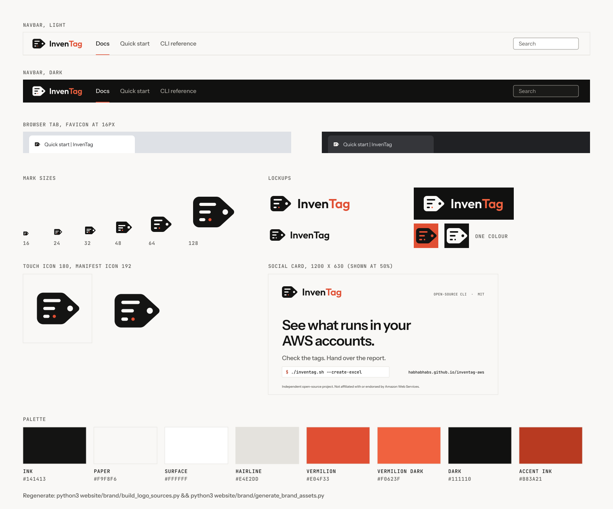

# InvenTag brand assets



## The mark

A luggage tag (the **Tag**) whose body carries three inventory lines (the
**Inven**tory). A small accent square ends the third line, and the eyelet sits
at the tag's point. Lines, eyelet and accent square are cut-outs, so the mark
works in one colour on any background; the full-colour version fills the
accent square with vermilion.

The wordmark is **Outfit SemiBold (600)**, outlined to paths: "Inven" in ink,
"Tag" in vermilion. Outfit is only used for the logo; the site itself is set in
Instrument Sans and JetBrains Mono. The Outfit file the generator reads is
`fonts/outfit-latin-600-normal.woff2` (SIL OFL 1.1, licence in
`fonts/OFL-Outfit.txt`, npm `@fontsource/outfit@5.3.0`, SHA-256
`8cfe15c2c6de6ef8efff3eedbd52a383ac9ef23d6c23f6cd9f9b838f5f37dc36`). The site
does not load it: every published SVG has the wordmark as paths.

### Geometry (64-unit grid, `build_logo_sources.py` is the single source)

| Part | Value |
|---|---|
| Tag silhouette | `M14 12H36.5A8 8 0 0 1 42 14.2L58.6 29.4A4 4 0 0 1 58.6 34.6L42 49.8A8 8 0 0 1 36.5 52H14A8 8 0 0 1 6 44V20A8 8 0 0 1 14 12Z`: x 6 to 58.6, y 12 to 52 (40 tall), left corners r 8, tip r 4 |
| Lines | 4 tall, r 2, at y 20 / 30 / 40, x from 14; widths 22 / 15 / 8 (even 10-unit pitch, 6-unit gaps) |
| Eyelet | circle r 3.6 at (48, 32), on the tag's centre line |
| Accent square | 4 x 4 at (26, 40), r 2, one 4-unit gap after the third line |
| Lockup | mark at x 0, wordmark at x 76, Outfit 600 at 34 units, tracking -0.01em, cap height centred on y 32; viewBox height 64, width = 76 + text + 6 |
| Small mark (`logo-small*.svg`, favicons) | every edge on a 4-unit step, so 1 px at 16 px: tag (4,12) to (60,52), r 4, tip r 2; three 1 px lines at y 24 / 32 / 40 (widths 24 / 16 / 8), 1 px accent square at (24, 40), 2 px eyelet at (44, 28) |

Use the small mark up to 48 px (the 16 / 32 / 48 px favicon sizes are 1x, 2x
and 3x of the same pixel grid). From 64 px up use the full mark.

### Clear space and minimum sizes

- **Clear space:** at least one line pitch (10 units, a quarter of the tag's
  height) on every side of the mark or lockup, measured from the tag and the
  letters. The SVGs already include 6 units on the left and right (and 12 above
  and below the tag), so add 4 units at the sides in layout.
- **Minimum size:** mark 16 px wide (use `logo-small.svg`, check by rendering
  16 / 32 / 48 px; `npm run brand` writes `favicon.ico` with all three and
  `preview.png` shows the 16 px tab). Lockup: 24 px tall (cap height about 9 px).
- **Navbar:** the lockup is 40 px tall (`img/logo-wordmark*.svg`); the tag is
  25 px tall there.

### Colour rules

- Light backgrounds: ink `#141413` and vermilion `#E04F33`.
- Dark backgrounds: paper `#F9F8F6` and vermilion **`#F0623F`** (the lighter
  vermilion is used on dark so the accent keeps a comfortable margin; `#E04F33`
  also passes at 4.80:1 on `#111110`).
- One colour: `currentColor`, black or white. The accent square is a cut-out,
  "Tag" takes the same colour as "Inven". No accent colour in one-colour use.
- On a vermilion field use `logo-on-brand.svg` (ink, accent square cut out).
- Flat only: no gradients, glow, shadows, outlines or effects.

### Do and don't

- Do give the mark a flat background (paper, ink, vermilion or a white page).
- Do use the lockup where there is room for the name, the mark alone for
  avatars, favicons and app icons.
- Don't recolour "Inven" or the tag in vermilion, or put "Tag" in any colour
  but the accent (or the one colour in mono use).
- Don't use the vermilion accent for the mark's body or for small text:
  `#E04F33` on paper is 3.71:1, fine for graphics and large type but not for
  body text (use accent ink `#B83A21`, 5.40:1).
- Don't stretch, rotate, outline, or re-set the wordmark in another font; use
  the SVGs.
- Don't add AWS logos, the AWS smile or arrow, or AWS service icons to any
  lockup.

## Palette and contrast

Contrast is WCAG 2.x relative luminance, computed for every pair the site uses
(the same values are in `src/css/custom.css`).

| Token | Light | Dark |
|---|---|---|
| Background | `#F9F8F6` | `#111110` |
| Surface | `#FFFFFF` | `#1A1A18` |
| Code background | `#F3F1EC` | `#161615` |
| Text (ink) | `#141413` | `#F2F0EC` |
| Secondary text | `#575652` | `#A8A59E` |
| Hairline (decorative) | `#E4E2DD` | `#2A2A27` |
| Control border | `#8A8780` | `#77756E` |
| Vermilion (fills, focus ring) | `#E04F33` | `#E04F33` |
| Logo accent | `#E04F33` | `#F0623F` |
| Accent text | `#B83A21` | `#F07A5F` |

| Pair | Ratio | Needs | Result |
|---|---|---|---|
| Ink `#141413` on background `#F9F8F6` / surface `#FFFFFF` | 17.37 / 18.43 | 4.5 | pass |
| Secondary `#575652` on background / surface / code `#F3F1EC` | 6.92 / 7.35 / 6.51 | 4.5 | pass |
| Accent text `#B83A21` on background / surface / active tint `#FBEDE9` | 5.40 / 5.73 / 5.02 | 4.5 | pass |
| **Ink `#141413` on vermilion `#E04F33`** (primary button) | 4.68 | 4.5 | pass |
| White `#FFFFFF` on vermilion (not used) | 3.94 | 4.5 | **fail, rejected** |
| Vermilion focus ring on background / surface | 3.71 / 3.94 | 3 (non-text) | pass |
| Control border `#8A8780` on background / surface | 3.38 / 3.58 | 3 (non-text) | pass |
| Dark text `#F2F0EC` on `#111110` / `#1A1A18` | 16.60 / 15.31 | 4.5 | pass |
| Dark secondary `#A8A59E` on `#111110` / `#1A1A18` / code `#161615` | 7.68 / 7.09 / 7.36 | 4.5 | pass |
| Dark accent text `#F07A5F` on `#111110` / `#1A1A18` / tint `#2A1C17` | 6.89 / 6.35 / 5.99 | 4.5 | pass |
| Vermilion focus ring on `#111110` / `#1A1A18` | 4.80 / 4.43 | 3 (non-text) | pass |
| **Logo accent** `#E04F33` on paper `#F9F8F6` / white | 3.71 / 3.94 | 3 (graphical object) | pass |
| **Logo accent** `#F0623F` on dark `#111110` / `#1A1A18` | 5.87 / 5.41 | 3 (graphical object) | pass |
| Logo ink `#141413` on paper `#F9F8F6`; paper `#F9F8F6` on `#111110` | 17.37 / 17.80 | 3 | pass |
| Logo ink `#141413` on vermilion `#E04F33` (`logo-on-brand.svg`) | 4.68 | 3 | pass |
| Dark control border `#77756E` on `#111110` / `#1A1A18` | 4.10 / 3.78 | 3 (non-text) | pass |
| Admonition labels, light (on `#FFFFFF`): tip `#2F6B3A`, info `#1F4E8C`, warning `#8A4B00` | 6.39 / 8.31 / 6.80 | 4.5 | pass |
| Admonition labels, dark (on `#1A1A18`): tip `#A9C98F`, info `#8DB4E2`, warning `#E0B070` | 9.49 / 8.10 / 8.81 | 4.5 | pass |

Syntax colours (`src/theme-config/prism.ts`), against the code background and
against the highlighted-line background (`#F7E4DD` light, `#2B1F1A` dark):

| Token | Light | on `#F3F1EC` | on highlight | Dark | on `#161615` | on highlight |
|---|---|---|---|---|---|---|
| plain | `#141413` | 16.33 | | `#F2F0EC` | 15.91 | |
| comment | `#66645E` | 5.24 | 4.82 | `#9C998F` | 6.35 | 5.61 |
| keyword | `#B83A21` | 5.08 | 4.66 | `#F07A5F` | 6.60 | 5.83 |
| string | `#2F6B3A` | 5.66 | 5.20 | `#A9C98F` | 9.86 | |
| function | `#1F4E8C` | 7.36 | | `#8DB4E2` | 8.42 | |
| number | `#8A4B00` | 6.03 | | `#E0B070` | 9.15 | |
| punctuation | `#575652` | 6.51 | | `#B5B2AA` | 8.55 | |
| property | `#6B3F8C` | 6.85 | | `#C9A6E0` | 8.64 | |
| variable | `#2F5D7C` | 6.25 | | `#8FC1D9` | 9.31 | |

`npm run check:a11y` measures the rendered pages as well, so a new colour that
breaks these ratios fails the check.

## Files

| Source (`src/`) | Published as (`../static/`) | Notes |
|---|---|---|
| `logo.svg` | `img/logo.svg` | ink tag, vermilion accent square: light backgrounds |
| `logo-dark.svg` | `img/logo-dark.svg` | paper tag, `#F0623F` accent square: dark backgrounds |
| `logo-on-brand.svg` | `img/logo-on-brand.svg` | one-colour ink mark (accent cut out) for a vermilion field |
| `logo-mono*.svg` | same names | one colour: `currentColor`, black, white (accent square is a cut-out) |
| `logo-small.svg`, `logo-small-dark.svg` | same names, `img/favicon-32.png`, `img/favicon.ico` (16/32/48) | pixel-aligned small mark (1 px = 4 units at 16 px); PNG/ICO get a 1px paper halo so they stay visible on dark tab bars |
| `favicon.svg` | `img/favicon.svg` | small mark; ink + `#E04F33` in light browsers, paper + `#F0623F` in dark ones (`prefers-color-scheme`) |
| `logo-wordmark*.svg` | same names | horizontal lockups: light, dark, one-colour; the navbar logo (`docusaurus.config.ts`) |
| `social-card.svg` | `img/social-card.png` (1200x630) | Open Graph / Twitter card, flat paper background, all text outlined |
| | `img/apple-touch-icon.png` (180) | mark on an opaque paper tile |
| | `img/logo-192.png`, `img/logo-512.png`, `img/logo-maskable-512.png` | web-manifest icons (maskable keeps the mark in the safe zone) |
| | `site.webmanifest` | name, colours, icons (paths include `/inventag-aws/`) |
| `preview-sheet.svg` | `preview.png` (here) | the logo in context, with the real PNGs embedded |

## Regenerating the PNGs, favicons and social card

```bash
# needs rsvg-convert (brew install librsvg / apt install librsvg2-bin) and Pillow
python3 website/brand/generate_brand_assets.py
# or: cd website && npm run brand
```

This rasterises the SVGs in `src/`, writes everything listed above, and
re-renders `preview.png`. Look at the preview (the browser-tab favicon
especially) before committing.

## Changing the design

Shapes, colours, the wordmark, the social card and the preview sheet are
generated by `build_logo_sources.py`, the single source of truth. The wordmark
uses `fonts/outfit-latin-600-normal.woff2`; the social card also uses the
site's own Instrument Sans and JetBrains Mono files in `website/static/fonts`:

```bash
pip install fonttools brotli uharfbuzz
python3 website/brand/build_logo_sources.py
python3 website/brand/generate_brand_assets.py
```

Keep the social card's claims to things the code does, and keep the "not
affiliated with or endorsed by Amazon Web Services" line. The card has no
version number on purpose, so it does not go stale at each release.
